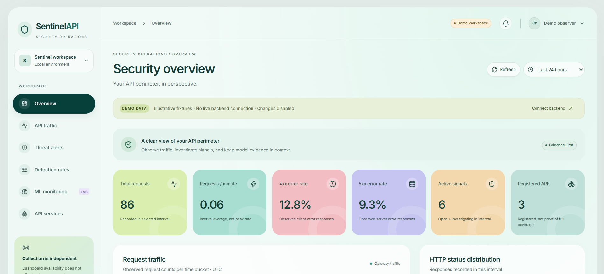
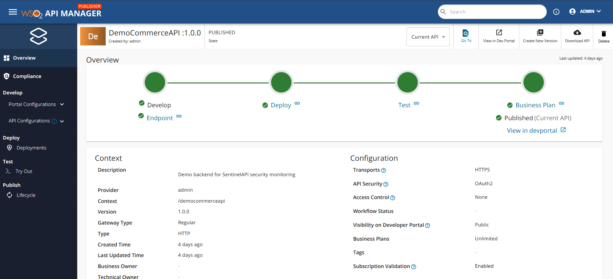
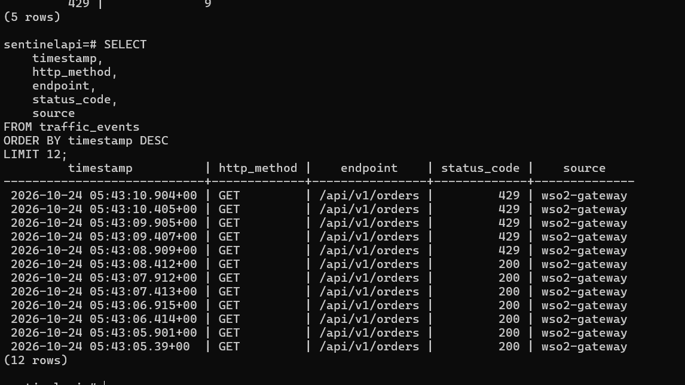
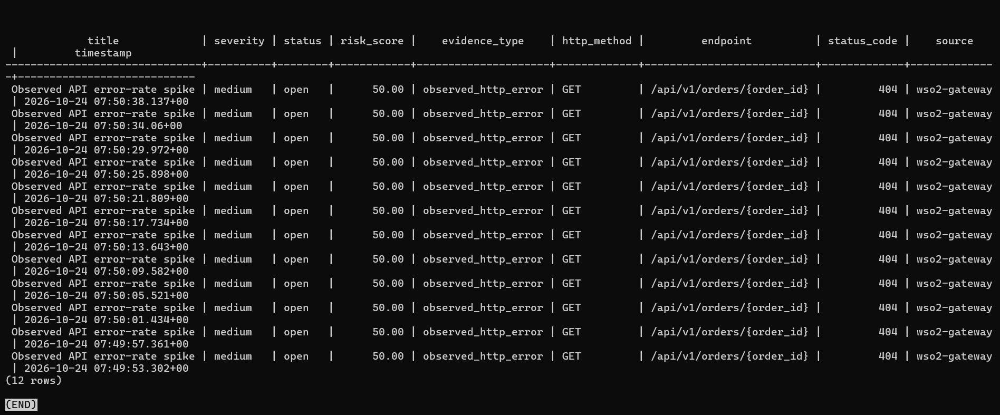
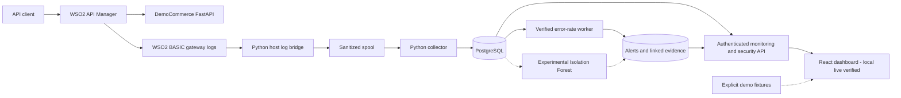

<div align="center">

# SentinelAPI

### API Security Monitoring & Anomaly Detection Platform

**Turning WSO2 API gateway activity into evidence-backed security insights.**


[Read Technical Article](https://kaveesha-portfolio-khaki.vercel.app/blog/engineering-sentinelapi-api-security-monitoring) · [View Portfolio Case Study](https://kaveesha-portfolio-khaki.vercel.app/projects/sentinelapi) · [GitHub Source](https://github.com/Kaveesha23dil/sentinelapi)

[Overview](#overview) · [Features](#key-features) · [Architecture](#system-architecture) · [Screenshots](#project-preview) · [Technology Stack](#technology-stack) · [Getting Started](#getting-started) · [Testing](#testing--verification) · [Documentation](#documentation)

</div>

## Overview

SentinelAPI is an API monitoring and anomaly detection platform built around WSO2 API Manager. It combines gateway traffic collection, PostgreSQL persistence, rule-based detection, Isolation Forest experimentation, and a React dashboard to investigate unusual API behavior.

Gateway authentication and throttling control whether requests may proceed. Understanding unusual API behavior also requires a reliable record of what happened. SentinelAPI collects sanitized gateway logs, evaluates stored events, and links alerts to supporting evidence so an investigator can inspect the reason for a signal.

**Status:** portfolio/research prototype with verified local gateway ingestion, error-rate alerts, and authenticated dashboard integration. Monitoring runs independently of API requests. Live ML acceptance and public cloud deployment remain unverified.

## Engineering Highlights

- **WSO2 Gateway Security:** OAuth 2.0 and application throttling exercised with actual HTTP **200, 401, and 429** responses; not a quota-timing benchmark.
- **Real Gateway Telemetry:** **99 genuine gateway events** persisted at the documented local verification point: 75 preserved records plus 24 controlled requests. Historical count, not a live metric.
- **Evidence-Backed Detection:** one persisted error-rate alert with **16 linked gateway evidence records** from controlled testing, not a confirmed cyberattack.
- **ML Experimentation:** Isolation Forest evaluated on **180 held-out synthetic windows** after 360 training minutes. Offline experiment, not production attack-detection performance.

See the [controlled runtime validation](docs/detection-runtime-repair.md), [release verification](docs/release-verification.md), and subsequent [authenticated dashboard verification](docs/dashboard-backend-auth.md).

## Project Preview



*SentinelAPI monitoring dashboard — application demonstration using illustrative fixture data.*

### WSO2 API Gateway Integration



DemoCommerceAPI publication and OAuth 2.0 configuration in WSO2 API Manager. Actual gateway routing and security behavior are established by the verification reports; this configuration screen alone does not prove execution.

### Gateway Security Verification



**Controlled local verification:** persisted genuine WSO2 events include HTTP 200 and HTTP 429 responses. This is collected telemetry, not a response-only authentication screenshot or a quota-timing benchmark. Clean HTTP 200/401 response captures are still needed; existing token-bearing and personal-path captures remain excluded.

### Evidence-Backed Detection



Controlled local runtime validation: an API error-rate alert linked to genuine WSO2 gateway events. The displayed SQL result includes 12 evidence rows; independent verification confirmed 16 linked records.

### Machine Learning Experiment


Isolation Forest offline evaluation using controlled synthetic traffic windows. Results are experimental and do not establish production attack-detection accuracy. Live ML scoring remains unverified.

Images are unchanged genuine application/configuration captures or a retained experiment chart. See the [evidence audit](docs/release-evidence-audit.md) for publication decisions and the [organized local collection](project/README.md) for original-file categories. Demo fixtures and controlled runtime measurements remain distinct.

## Key Features

### API Gateway Security

WSO2 publication, revisions, subscriptions, OAuth 2.0 authentication, application-level throttling, and request/response observations against the FastAPI DemoCommerce service.

### Telemetry Collection

WSO2 BASIC log parsing through a Python host bridge, sanitized spool, and collector into PostgreSQL. Durable checkpoints and deterministic event IDs support replay-safe collection; stored events omit bodies, headers, and raw addresses.

### Security Detection

Sliding-window error-rate evaluation, persistent alerts, incident deduplication, linked evidence, and reader/analyst/admin API capabilities. Of five tested strategies, **only error-rate detection has a verified live evidence adapter**; the other four remain disabled.

### Machine Learning

Per-API Isolation Forest scoring, finalized traffic-window features, model/artifact checks, and controlled evaluation with comparison charts. Optional worker inference is implemented; **live scoring acceptance remains pending**.

### Monitoring Dashboard

React/TypeScript views for **Overview, API traffic, Threat alerts, Detection rules, ML monitoring, and API services**, with incident details and authenticated FastAPI clients. Same-origin proxies and in-memory credentials support local live investigation. Demo mode is explicit and never substitutes for failed live requests.

## System Architecture



The top path handles API requests; WSO2 enforces authentication and throttling before forwarding to DemoCommerce. The observation path reads gateway logs and analyzes persisted events independently. Rules write evidence-linked alerts back to PostgreSQL. Dashed ML connections indicate implemented experimental integration awaiting live acceptance; fixture data is an explicit alternative dashboard mode.

WSO2, the host bridge, and the detection worker are independently managed processes. See [detailed architecture](docs/final-architecture.md) and the subsequent [dashboard integration update](docs/dashboard-backend-auth.md).

## Technology Stack

| Layer | Technology |
| --- | --- |
| API Management | WSO2 API Manager 4.5.0 |
| Backend | Python 3.12, FastAPI |
| Data Storage | PostgreSQL 17 (Compose image: 17.11) |
| Database Management | SQLAlchemy 2, Alembic, psycopg 3 |
| Collection | Python, Docker-based log transport |
| Detection | Python, sliding-window rules |
| Machine Learning | scikit-learn Isolation Forest, NumPy, pandas |
| Frontend | React 19, TypeScript, Vite |
| Infrastructure | Docker, Docker Compose |
| Testing | Pytest, Vitest, Playwright |

## Getting Started

### Option A — Explore the dashboard

Requires Git and compatible Node.js/npm; the frontend Dockerfile uses Node 26.7.0. Install dependencies from the repository lockfile:

```powershell
cd frontend
npm.cmd ci
npm.cmd run dev
```

Open [http://127.0.0.1:5173](http://127.0.0.1:5173) and select **Explore demo**. This read-only mode uses fixtures and requires neither WSO2 nor PostgreSQL. The development configuration enables demo entry; production configuration disables it.

To inspect genuine data, select **Connect backend** and privately supply the required monitoring and security credentials. Both development proxies currently target the combined application on loopback port 8010. Never put credentials in URLs, public config.js, or Vite variables.

### Option B — Run the full local integration

Read the [safe local runtime guide](docs/final-deployment.md) before starting services, then apply the later [dashboard authentication and reader-grant instructions](docs/dashboard-backend-auth.md).

Prerequisites include Python 3.12, Docker Desktop/Compose, an independently managed WSO2 API Manager 4.5.0 runtime, trusted local TLS certificates, private credentials, and PostgreSQL configuration.

1. Inspect existing containers, networks, database volumes, and configuration. Copy `.env.example` only if `.env` does not already exist; preserve existing secrets and data.
2. Back up the database, apply reviewed Alembic migrations with the owner/tooling role, and provision scoped runtime roles before starting database-dependent services.
3. Configure DemoCommerce publication, backend routing, OAuth application/subscription, and gateway revisions in WSO2. The actual gateway context is `/democommerceapi/1.0.0`.
4. Start the collector and monitoring service, the explicit host log bridge, then the independent detection worker. Apply the read-only dashboard grants and configure its security credential as described in the later repair guide.
5. Start Vite separately or use the optional Nginx dashboard overlay. Enable ML only with a trusted, approved, API-scoped model artifact and the optional ML overlay.

The runbooks retain migration/provisioning commands, service ordering, safe stops, and authorized traffic checks. **Do not reset databases, delete volumes, or recreate persistent containers merely to try the project.** `--no-recreate` preserves existing containers but can also preserve stale code. A listening port is not readiness evidence. Compose does not provision WSO2 or launch the host bridge.

## Testing & Verification

The following are retained results at documented verification points, **not a fresh full-suite run for this README update**. Groups overlap and must not be summed into a single test count.

| Verification scope | Recorded result | Evidence |
| --- | --- | --- |
| Backend/tools/DemoCommerce host suite | 155 passed + four passing subtests | [Release verification](docs/release-verification.md) |
| Guarded PostgreSQL persistence/detection/migration/dashboard SQL | 21 passed | [Release verification](docs/release-verification.md) |
| Linux collector and DB-backed monitoring | 31 passed | [Release verification](docs/release-verification.md) |
| Direct Windows collector fixtures | 18 passed, **2 failed** (`os.O_DIRECTORY`) | [Release verification](docs/release-verification.md) |
| Frontend unit / Chromium fixture and mocked workflows | **37 passed / 7 passed** in later dashboard repair | [Dashboard verification](docs/dashboard-backend-auth.md) |
| Frontend lint / typecheck / production build | Passed in dashboard repair | [Dashboard verification](docs/dashboard-backend-auth.md) |
| Focused backend suite in updated Choreo image | 106 passed; fresh image build passed | [Security build repair](docs/choreo-security-build.md) |

The later dashboard repair supersedes the older 36-test frontend snapshot and separately verifies six authenticated sections through Vite and Nginx. These are historical local results, not a claim that services are running now.

The 106-test cloud-image suite is narrower than the full backend suite. Broader image-only testing encountered missing ML dependencies, unconfigured database tests, and an absent root Compose fixture; details remain in the [cloud verification report](docs/choreo-deployment.md).

Useful frontend checks, from `frontend/`:

```powershell
npm.cmd test
npm.cmd run lint
npm.cmd run typecheck
npm.cmd run build
```

For full commands, platform-specific results, guarded test-database setup, and browser capture handling, use [release verification](docs/release-verification.md) and [dashboard verification](docs/dashboard-backend-auth.md). Never point destructive database tests at the project database.

## ML Evaluation

Isolation Forest provides an unsupervised way to explore unusual API behavior without assuming labeled attacks are available. Finalized 60-second windows contain request count, 4xx/5xx ratios, unique endpoint count, GET/POST ratios, and status-code diversity. Rule detection applies an explicit error threshold; model scoring identifies departures from learned behavior. Neither establishes malicious intent.

**Offline synthetic evaluation:** 360 training minutes and 180 held-out minutes (60 normal, 120 controlled-scenario windows), reproduced in the release audit.

| Detector | Precision | Recall | F1 | False-positive rate |
| --- | ---: | ---: | ---: | ---: |
| Isolation Forest | 0.931034 | 0.450000 | 0.606742 | 0.066667 |
| Configured error-rate rule | 1.000000 | 0.200000 | 0.333333 | 0.000000 |

These measure agreement with synthetic labels, **not real-world security accuracy**. Both detectors miss scenarios. The rule uses 300 seconds of history versus 60-second ML windows, so this comparison does not establish general superiority. No approved live artifact or accepted live scoring is demonstrated by these metrics. See [evaluation design and reproduction](docs/ml-evaluation.md).

## Current Limitations

- Research prototype: production identity, retention, backup restoration, and hardening remain work in progress. The local demo backend can bypass the gateway.
- BASIC telemetry lacks trusted end-user identity and measured latency; four detection strategies await suitable evidence adapters.
- ML results are offline and synthetic; live scoring acceptance is pending.
- Collection depends on the explicit host log bridge. Two direct Windows collector fixtures still fail on `os.O_DIRECTORY`; the portability fix remains on an unmerged branch.
- Public cloud deployment and platform scan acceptance are unverified. Previously exposed database credentials require coordinated rotation before deployment.

See the [release checklist](docs/portfolio-release-checklist.md) and [technical audit](docs/final-project-audit.md) for remaining gates. Historical reports retain their original baselines.

## Documentation

| Document | Purpose |
| --- | --- |
| [System Architecture](docs/final-architecture.md) | Component design and data flow |
| [Local Setup Guide](docs/final-deployment.md) | Safe service startup, migrations, and reproduction |
| [WSO2 Integration](docs/wso2-api-integration.md) | API publication, gateway routing, and security |
| [Detection Documentation](docs/threat-detection-architecture.md) | Rule-based analysis and evidence processing |
| [ML Evaluation](docs/ml-evaluation.md) | Isolation Forest experiment and limitations |
| [Verification Report](docs/release-verification.md) | Retained tests and genuine runtime observations |
| [Dashboard Verification](docs/dashboard-backend-auth.md) | Later authenticated local integration results |
| [Evidence Audit](docs/release-evidence-audit.md) | Screenshot provenance and privacy review |
| [Technical Article](https://kaveesha-portfolio-khaki.vercel.app/blog/engineering-sentinelapi-api-security-monitoring) | Published engineering walkthrough |
| [Portfolio Case Study](https://kaveesha-portfolio-khaki.vercel.app/projects/sentinelapi) | Project overview and engineering outcomes |

## What I Learned

I learned to connect API publication, OAuth 2.0, subscriptions, and throttling in WSO2 with the separate work of observing API behavior. Building the collection pipeline taught me to treat sanitization, deduplication, checkpoints, and database migrations as correctness concerns. Linking alerts to stored events made detection explainable; evaluating Isolation Forest taught me to distinguish synthetic results from deployment evidence. Integrating the dashboard required debugging credentials, database grants, proxies, and health across independent services.

**[Read the Technical Article](https://kaveesha-portfolio-khaki.vercel.app/blog/engineering-sentinelapi-api-security-monitoring)** · **[View the Portfolio Case Study](https://kaveesha-portfolio-khaki.vercel.app/projects/sentinelapi)**
