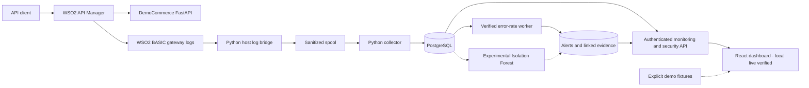

<div align="center">

# SentinelAPI

**API Security Monitoring & Anomaly Detection Platform**


[Technical Article](https://kaveesha-portfolio-khaki.vercel.app/blog/engineering-sentinelapi-api-security-monitoring) · [Portfolio Case Study](https://kaveesha-portfolio-khaki.vercel.app/projects/sentinelapi) · [GitHub Source](https://github.com/Kaveesha23dil/sentinelapi)

[Overview](#overview) · [Features](#key-features) · [Architecture](#system-architecture) · [Screenshots](#project-preview) · [Technology Stack](#technology-stack) · [Getting Started](#getting-started) · [Testing](#testing--verification) · [Documentation](#documentation)

</div>

## Overview

SentinelAPI transforms WSO2 API Manager gateway telemetry into evidence-backed security insights through rule-based detection, PostgreSQL event processing, machine-learning experimentation, and a React monitoring dashboard.

Gateway authentication and throttling control whether requests may proceed. Understanding unusual API behavior also requires a reliable record of what happened. SentinelAPI collects sanitized gateway logs, evaluates stored events, and links alerts to supporting evidence so an investigator can inspect the reason for a signal.

**Project status:** a portfolio and research prototype with verified local gateway ingestion, error-rate detection, and authenticated dashboard integration. Isolation Forest has an offline synthetic evaluation; live ML scoring acceptance remains pending. Analysis runs outside the request path and does not automatically block traffic. No successful public cloud deployment is claimed.

## Engineering Highlights

| Highlight | Verified scope |
| --- | --- |
| **WSO2 API Gateway Integration** | API publication and subscriptions, OAuth 2.0 authentication, and application-level throttling exercised through actual gateway responses. Retained HTTP 429 observations are not a quota-timing benchmark. |
| **99 Gateway Events** | Historical local validation preserved the original 75 records and correlated 24 additional controlled requests. This is a documented snapshot, not a live counter. |
| **16 Linked Evidence Records** | A genuine persisted error-rate alert was linked to 16 supporting gateway events during controlled local validation, not a real-world attack. |
| **Isolation Forest Evaluation** | An offline experiment used 360 training minutes and 180 held-out synthetic traffic windows. It does not establish real-world attack-detection accuracy. |

See the [controlled runtime validation](docs/detection-runtime-repair.md), [release verification](docs/release-verification.md), and subsequent [authenticated dashboard verification](docs/dashboard-backend-auth.md).

## Project Preview

### Monitoring dashboard — demo fixtures


Actual React application in **demo mode**. Counts, services, and alerts shown here are fixtures, not genuine runtime measurements. Authenticated local dashboard verification is documented separately; it does not change this screenshot's provenance.

### Persisted alert and gateway evidence — controlled local runtime


Genuine stored error-rate alert and supporting events from a controlled WSO2 test. This query displays 12 rows; independent database/API checks confirmed **16 total evidence links**.

### WSO2 API publication and security configuration


Publisher configuration for DemoCommerceAPI. The lifecycle screen shows publication and OAuth2 configuration; executed gateway behavior is established by the linked verification reports, not this image alone.

These unchanged images were selected from the [evidence and privacy audit](docs/release-evidence-audit.md) and visually reviewed again for this README. Token-bearing, raw-address, and personal-path captures are excluded.

## Key Features

### WSO2 API Management

- DemoCommerce API publication, versioning, revisions, subscriptions, and OAuth 2.0 gateway authentication.
- Application-level throttling with retained HTTP 429 responses and bounded security verification tools.
- FastAPI demo service with health, profile, orders, and simulated payments; business records are in memory.

### Gateway Telemetry Processing

- WSO2 BASIC API log parsing, route sanitization, normalization, and explicit host-side log transport.
- Durable spool and checkpoint-based collection with deterministic event IDs for deduplication.
- PostgreSQL event persistence and replay/conflict handling. Stored telemetry omits bodies, headers, and raw addresses.

### Security Detection

- Sliding-window API error-rate evaluation with persisted alerts, duplicate suppression, and linked gateway evidence.
- Scoped monitoring and security access, including reader/analyst/admin capability checks.
- Five implemented rule strategies with tests; **only error-rate detection has a verified live evidence adapter**. The other four remain disabled.

### Machine Learning Experimentation

- Per-API Isolation Forest scoring over finalized traffic-window features.
- Offline synthetic evaluation, confusion matrices, score distributions, and versioned model/artifact checks.
- Source-integrated optional worker inference; **live ML scoring acceptance remains pending**.

### Monitoring Dashboard

- React/TypeScript navigation: **Overview, API traffic, Threat alerts, Detection rules, ML monitoring, and API services**, plus incident-detail views.
- Authenticated monitoring/security clients, same-origin proxies, in-memory credentials, filters, and evidence inspection.
- Explicit demo, live, and unavailable states; failed live requests never silently fall back to fixtures.
- Local authenticated rendering verified through Vite and production Nginx. Unconfigured ML data remains unavailable.

## System Architecture



The top path handles API requests; WSO2 enforces authentication and throttling before forwarding to DemoCommerce. The observation path reads gateway logs and analyzes persisted events independently. Rules write evidence-linked alerts back to PostgreSQL. Dashed ML connections indicate implemented experimental integration awaiting live acceptance; fixture data is an explicit alternative dashboard mode.

WSO2 is managed separately from this project's Compose stack. The bridge is an explicit host process, the detector is a separate worker, and Uvicorn does not start either. See [detailed architecture](docs/final-architecture.md) and the later [dashboard proxy/authentication update](docs/dashboard-backend-auth.md), which supersedes that architecture document's older dashboard-pending statements.

## Technology Stack

| Layer | Technology |
| --- | --- |
| API Management | WSO2 API Manager 4.5.0 |
| Backend | Python 3.12, FastAPI |
| Data Storage | PostgreSQL 17 (Compose image: 17.11) |
| Database Management | SQLAlchemy 2, Alembic, psycopg 3 |
| Collection | Python, Docker-based log transport |
| Detection | Python, sliding-window rules |
| Machine Learning | scikit-learn Isolation Forest, NumPy, pandas |
| Frontend | React 19, TypeScript, Vite |
| Infrastructure | Docker, Docker Compose |
| Testing | Pytest, Vitest, Playwright |

## Getting Started

### Option A — Explore the dashboard

Requires Git and compatible Node.js/npm; the frontend Dockerfile uses Node 26.7.0. Install dependencies from the repository lockfile:

```powershell
cd frontend
npm.cmd ci
npm.cmd run dev
```

Open [http://127.0.0.1:5173](http://127.0.0.1:5173) and select **Explore demo**. This read-only mode uses fixtures and requires neither WSO2 nor PostgreSQL. The development configuration enables demo entry; production configuration disables it.

To inspect genuine data, select **Connect backend** and privately supply the required monitoring and security credentials. Both development proxies currently target the combined application on loopback port 8010. Never put credentials in URLs, public config.js, or Vite variables.

### Option B — Run the full local integration

Read the [safe local runtime guide](docs/final-deployment.md) before starting services, then apply the later [dashboard authentication and reader-grant instructions](docs/dashboard-backend-auth.md).

Prerequisites include Python 3.12, Docker Desktop/Compose, an independently managed WSO2 API Manager 4.5.0 runtime, trusted local TLS certificates, private credentials, and PostgreSQL configuration.

1. Inspect existing containers, networks, database volumes, and configuration. Copy `.env.example` only if `.env` does not already exist; preserve existing secrets and data.
2. Back up the database, apply reviewed Alembic migrations with the owner/tooling role, and provision scoped runtime roles before starting database-dependent services.
3. Configure DemoCommerce publication, backend routing, OAuth application/subscription, and gateway revisions in WSO2. The actual gateway context is `/democommerceapi/1.0.0`.
4. Start the collector and monitoring service, the explicit host log bridge, then the independent detection worker. Apply the read-only dashboard grants and configure its security credential as described in the later repair guide.
5. Start Vite separately or use the optional Nginx dashboard overlay. Enable ML only with a trusted, approved, API-scoped model artifact and the optional ML overlay.

The runbooks retain migration/provisioning commands, service ordering, safe stops, and authorized traffic checks. **Do not reset databases, delete volumes, or recreate persistent containers merely to try the project.** `--no-recreate` preserves existing containers but can also preserve stale code. A listening port is not readiness evidence. Compose does not provision WSO2 or launch the host bridge.

## Testing & Verification

The following are retained results at documented verification points, **not a fresh full-suite run for this README update**. Groups overlap and must not be summed into a single test count.

| Verification scope | Recorded result | Evidence |
| --- | --- | --- |
| Backend/tools/DemoCommerce host suite | 155 passed + four passing subtests | [Release verification](docs/release-verification.md) |
| Guarded PostgreSQL persistence/detection/migration/dashboard SQL | 21 passed | [Release verification](docs/release-verification.md) |
| Linux collector and DB-backed monitoring | 31 passed | [Release verification](docs/release-verification.md) |
| Direct Windows collector fixtures | 18 passed, **2 failed** (`os.O_DIRECTORY`) | [Release verification](docs/release-verification.md) |
| Frontend unit / Chromium fixture and mocked workflows | **37 passed / 7 passed** in later dashboard repair | [Dashboard verification](docs/dashboard-backend-auth.md) |
| Frontend lint / typecheck / production build | Passed in dashboard repair | [Dashboard verification](docs/dashboard-backend-auth.md) |
| Focused backend suite in updated Choreo image | 106 passed; fresh image build passed | [Security build repair](docs/choreo-security-build.md) |

The later 37-test frontend run supersedes the release report's 36-test snapshot. Live authenticated dashboard checks are separate from mocked Chromium tests: six sections were verified through both Vite and Nginx, with read-only role enforcement and no fixture fallback. These remain historical local observations, not claims about services running now.

The narrow cloud-image suite is not a full backend pass. A broad run encountered missing ML dependencies, unconfigured database tests, and a root Compose fixture absent from the backend-only image; see [cloud preparation verification](docs/choreo-deployment.md). The security repair verifies package versions, not a successful platform Trivy scan or deployment.

Useful frontend checks, from `frontend/`:

```powershell
npm.cmd test
npm.cmd run lint
npm.cmd run typecheck
npm.cmd run build
```

For full commands, platform-specific results, guarded test-database setup, and browser capture handling, use [release verification](docs/release-verification.md) and [dashboard verification](docs/dashboard-backend-auth.md). Never point destructive database tests at the project database.

## ML Evaluation

Isolation Forest provides an unsupervised way to explore unusual API behavior without assuming labeled attacks are available. Finalized 60-second windows contain request count, 4xx/5xx ratios, unique endpoint count, GET/POST ratios, and status-code diversity. Rule detection applies an explicit error threshold; model scoring identifies departures from learned behavior. Neither establishes malicious intent.

**Offline synthetic evaluation:** 360 training minutes and 180 held-out minutes (60 normal, 120 controlled-scenario windows), reproduced in the release audit.

| Detector | Precision | Recall | F1 | False-positive rate |
| --- | ---: | ---: | ---: | ---: |
| Isolation Forest | 0.931034 | 0.450000 | 0.606742 | 0.066667 |
| Configured error-rate rule | 1.000000 | 0.200000 | 0.333333 | 0.000000 |

These measure agreement with synthetic labels, **not real-world security accuracy**. Both detectors miss scenarios. The rule uses 300 seconds of history versus 60-second ML windows, so this comparison does not establish general superiority. No approved live artifact or accepted live scoring is demonstrated by these metrics. See [evaluation design and reproduction](docs/ml-evaluation.md).

## Current Limitations

- Portfolio/research prototype; production identity, operational hardening, retention, and backup restoration require further work. The loopback DemoCommerce port can bypass the gateway.
- BASIC telemetry does not establish trusted end-user identity or measured latency. Client-specific detection cannot infer those missing signals.
- Only error-rate detection has a verified live evidence adapter; four other implemented strategies remain disabled.
- Live ML acceptance is pending. Dashboard screenshots above are demo fixtures or explicitly labeled controlled evidence; local live verification does not turn fixtures into measurements.
- Two direct Windows collector fixtures still fail on this branch. The portability fix is documented on an unmerged branch; the working host bridge uses a Linux transport helper.
- Collection depends on the explicit host bridge and source-log availability. Process health alone does not establish complete telemetry.
- Public cloud deployment and platform vulnerability-scan acceptance are not established. Previously exposed database credentials require coordinated rotation before deployment; do not perform it as part of documentation setup.

See the [release checklist](docs/portfolio-release-checklist.md) and [technical audit](docs/final-project-audit.md). These retain earlier baseline findings; later dashboard/cloud reports describe scoped changes rather than rewriting historical evidence.

## Documentation

| Topic | Reference |
| --- | --- |
| Architecture | [System design and verification boundaries](docs/final-architecture.md) |
| WSO2 Integration | [API publication, gateway context, and security](docs/wso2-api-integration.md) |
| Local Runtime Guide | [Safe deployment and reproduction](docs/final-deployment.md) |
| Dashboard Integration | [Authenticated local rendering and scoped access](docs/dashboard-backend-auth.md) |
| Security Detection | [Detection architecture](docs/threat-detection-architecture.md) · [Controlled runtime validation](docs/detection-runtime-repair.md) |
| ML Evaluation | [Synthetic evaluation and reproduction](docs/ml-evaluation.md) |
| Verification Results | [Release checks](docs/release-verification.md) · [Cloud-image security repair](docs/choreo-security-build.md) |
| Evidence Audit | [Screenshot provenance and privacy](docs/release-evidence-audit.md) |
| Release Readiness | [Checklist and remaining gates](docs/portfolio-release-checklist.md) |
| Engineering History | [Development journal](docs/development-journal.md) |
| Technical Article | [Engineering SentinelAPI: API security monitoring](https://kaveesha-portfolio-khaki.vercel.app/blog/engineering-sentinelapi-api-security-monitoring) |

## What I Learned

I learned to connect API publication, OAuth 2.0, subscriptions, and throttling in WSO2 with the separate work of observing API behavior. Building the collection pipeline taught me to treat sanitization, deduplication, checkpoints, and database migrations as correctness concerns. Linking alerts to stored events made detection explainable; evaluating Isolation Forest taught me to distinguish synthetic results from deployment evidence. Integrating the dashboard required debugging credentials, database grants, proxies, and health across independent services.

**[Read the Technical Article](https://kaveesha-portfolio-khaki.vercel.app/blog/engineering-sentinelapi-api-security-monitoring)** · **[View the Portfolio Case Study](https://kaveesha-portfolio-khaki.vercel.app/projects/sentinelapi)**
