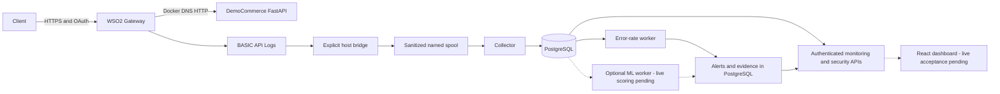

# SentinelAPI

An API security monitoring prototype combining **WSO2 API Manager 4.5.0**, sanitized gateway telemetry, evidence-linked detection, and a React investigation dashboard.

Authentication and rate limits answer whether a request may pass the gateway. Investigating unusual behavior also requires a trustworthy record of what happened. SentinelAPI explores that problem without putting its rule engine or experimental ML in the request path.

**Status:** portfolio research prototype, not production ready. A subsequent [controlled local runtime validation](docs/detection-runtime-repair.md) verified 24 fresh WSO2 requests through collection into a genuine error-rate alert with 16 evidence links and authenticated API retrieval. Full live ML/dashboard acceptance remains pending. Step 9 is preserved on an unmerged branch; the [final audit](docs/final-project-audit.md) and [documentation verification](docs/final-verification.md) retain their earlier source-baseline findings.

## Project objectives

Demonstrate WSO2 API lifecycle and gateway enforcement, build a privacy-conscious telemetry pipeline with replay-safe identity, connect explainable observations to stored evidence, and evaluate anomaly detection without confusing unusual behavior with malicious intent. The dashboard makes live, unavailable and demo data explicit.

The [portfolio release verification](docs/release-verification.md) records the newest executed checks and current runtime state; the [release checklist](docs/portfolio-release-checklist.md) lists remaining gates. No release, deployment badge, coverage percentage or published blog is claimed.

## Implemented features

- FastAPI DemoCommerce: health, profile, orders and simulated payments; business data is in memory.
- WSO2 OpenAPI, revision, OAuth application/subscription tooling and bounded security checks. Actual gateway route: `/democommerceapi/1.0.0`.
- BASIC API Log parsing, route sanitization, durable spool/checkpoints and deterministic event deduplication.
- PostgreSQL monitoring schema, reviewed Alembic migrations and scoped runtime roles.
- Five tested rule strategies; **only error-rate detection has a live evidence adapter**. Other strategies remain disabled.
- Experimental per-API Isolation Forest, finalized minute features, artifact digest checks and evidence-linked anomaly alerts.
- Seven React views with explicit demo provenance, authenticated API clients, memory-only credentials, filters and incident workflows.

## Architecture



Solid arrows describe implemented paths supported by retained controlled runtime evidence. Dashed ML/UI arrows are implemented source integrations awaiting live acceptance; current checks found no configured model artifact and zero ML windows. WSO2 emits the gateway logs; DemoCommerce is not the log producer. WSO2 handles lifecycle, subscription authorization, OAuth enforcement and configurable throttling; SentinelAPI observes out of band and does not automatically block requests. [Detailed architecture](docs/final-architecture.md).

## Application evidence

**Actual React application, demo fixtures only.** Counts, services and alerts are illustrative, not live gateway measurements.


**Genuine controlled runtime alert evidence.** This joined SQL view shows 12 rows of the actual alert's evidence; the independent database/API count is 16. It is a controlled local validation, not a real-world attack.


The [release evidence audit](docs/release-evidence-audit.md) reviews all 31 supplied captures and maps 13 byte-identical safe copies into final-blog. Token-bearing, raw-address and personal-path images remain excluded locally. A genuine Screenshot 06 was supplied, but needs a clean recapture because its prompt exposes a personal workspace path; the safe joined SQL view above is already available. Dashboard captures remain fixtures.

## Technology

WSO2 API Manager 4.5.0 · Python 3.12 · FastAPI · SQLAlchemy 2 · Alembic · PostgreSQL 17 · Docker Compose · scikit-learn Isolation Forest · React · TypeScript · Vite · Pytest · Vitest · Playwright.

## Try the dashboard

Prerequisites: Git, compatible Node/npm (Node 26.7.0/npm 11.19.0 were used in earlier verification), and the repository lockfile.

```powershell
cd frontend
npm.cmd ci
npm.cmd run dev
```

Open **http://127.0.0.1:5173** and select **Explore demo**. Demo is read-only and never substitutes for failed live requests. For real data, use **Connect backend** with private monitoring/security credentials. Development proxies target loopback 8010/8020; see `frontend/.env.example`. Never put tokens in Vite variables or URLs.

## Run the backend and WSO2 demo

Prerequisites: Python 3.12, Docker Desktop/Compose, the existing WSO2 installation, trusted local WSO2 certificate and private credentials. WSO2 is separately managed: Compose does **not** provision or restore it.

1. Follow the [safe deployment runbook](docs/final-deployment.md). Preserve containers, database data, volumes and WSO2 configuration.
2. Copy `.env.example` to `.env` only if `.env` does not exist. Replace applicable placeholders with distinct private secrets. Optional ML requires an independently approved artifact.
3. Inspect containers/network. Use selected-service `up --no-recreate`; this can preserve stale deployments as well as working ones.
4. Build persistence tooling, back up externally, apply `alembic upgrade head`, check drift and provision scoped roles before runtime services.
5. Inspect/import the real OpenAPI, set backend `http://democommerce:8000`, secure all operations, deploy a revision, publish and subscribe. [WSO2 configuration and context caveat](docs/wso2-api-integration.md).
6. Start collector/monitoring, the explicit host bridge, detector/security API, then frontend. ML is an opt-in overlay.

Core startup commands, after the runbook's backup, network, credential and migration prerequisites:

```powershell
docker compose -f compose.yaml -f compose.step6.yaml config --quiet
docker compose -f compose.yaml -f compose.step6.yaml build monitoring detector persistence democommerce
docker compose up -d --no-recreate postgres
docker compose --profile tools run --rm --no-deps persistence alembic upgrade head
docker compose --profile tools run --rm --no-deps persistence python -m sentinelapi.detection.provision
docker compose up -d --no-recreate democommerce collector monitoring
docker compose -f compose.yaml -f compose.step6.yaml up -d --no-recreate --no-deps detector security-api
```

Provision collector/monitoring roles using the separate owner-run procedure in the runbook before their first start; that procedure can rotate existing telemetry passwords and must use the intended credentials. Detection provisioning preserves existing passwords unless explicit rotation is requested. `--no-recreate` preserves existing containers and can preserve stale code: review any update separately. WSO2 is not created by these commands and no complete clean-machine WSO2 restore is automated.

**Separate host process:** Compose does not launch the WSO2 log bridge. With the established Python environment, run it in one host terminal:

```powershell
$env:PYTHONPATH='backend;collector;scripts'
.\.venv-step6\Scripts\python.exe scripts/bridge_api_logs.py --follow
```

The detector is another process (`python -m sentinelapi.detection.worker`) in its own Step 6 container, not a Uvicorn background task. Prefer Compose: root-directory host imports need `PYTHONPATH=backend`, scoped credentials and actual DB reachability. Do not expose the database or start duplicate workers just to test imports. ML runs in that worker only when an approved artifact is configured through the Step 7 overlay. Frontend Vite is a separate `npm.cmd run dev` terminal; Step 8 optionally supplies Nginx instead. See the runbook for safe stops without volume deletion.

The runbook includes actual commands, migrations, safe stops, ML evaluation and bounded authorized traffic. Loopback ports: DemoCommerce **8000**, monitoring **8010**, security/ML **8020**, Vite **5173**, optional Nginx dashboard **8080**, Publisher **https://localhost:9443/publisher**, gateway **https://localhost:8243/democommerceapi/1.0.0**. PostgreSQL has no host port. A listening port is not readiness evidence.

## Tests and measured results

```powershell
# Repository root; environment installation is in the runbook.
$env:PYTHONPATH='backend;scripts;collector'
.\.venv-step6\Scripts\python.exe -m pytest backend/tests scripts/tests demo-services/democommerce/tests --ignore=backend/tests/test_postgres.py --ignore=backend/tests/test_detection_postgres.py --ignore=backend/tests/test_ml_postgres.py --ignore=backend/tests/test_dashboard_postgres.py -q
# frontend directory
npm.cmd run lint
npm.cmd run typecheck
npm.cmd test
npm.cmd run build
$env:SENTINEL_SCREENSHOT_DIR='../.runtime/portfolio-release/browser-captures'
npm.cmd run test:browser
```

Newest executed release checks:

| Check | Actual result |
|---|---|
| Backend/tool/DemoCommerce host suite | 155 passed + four passing subtests |
| Guarded PostgreSQL persistence/detection/migration/dashboard SQL | 21 passed |
| Linux collector and DB-backed monitoring | 31 passed |
| Direct Windows collector fixtures | 18 passed, **2 failed** (`os.O_DIRECTORY`) |
| Frontend unit / Chromium | 36 passed / 7 passed |
| Lint / typecheck / production build | Passed |

All executed groups had zero skips/errors; the Windows group has the two stated failures. Some migration/collector cases overlap across commands/platforms: do not sum them as a single unique test count. Raw XML/traces remain ignored; [verification commands and sanitized results](docs/release-verification.md) retain the distinction between real DB tests, fixtures/mocks and live observations. The direct Windows transport fix remains on unmerged Step 9; the deployed Windows-host bridge uses a Linux transport helper and is working.

Current read-only runtime checks found PostgreSQL revision `b7d000000001`, **99 gateway events**, one medium/open risk-50 alert and **16 evidence links**, with monitoring/collector healthy. The [earlier controlled repair](docs/detection-runtime-repair.md) correlated all 24 generated requests and verified preservation of the original 75 events; this release audit did not generate a new workload. Nine retained events have HTTP 429. A configured 10PerMin policy and retained 429 observations are not a benchmark or proof of exact quota-window timing.

Historical Step 5 correlated **6 gateway responses with 6 database and monitoring records**, including a rejected request, retaining the count after replay. [Live source report](infrastructure/telemetry/e2e-verification.json).

Controlled synthetic ML evaluation, reproduced during the release audit: 360 training minutes, 180 held-out minutes (60 normal, 120 scenarios).

| Detector | Precision | Recall | F1 | False-positive rate |
|---|---:|---:|---:|---:|
| Isolation Forest | 0.931034 | 0.450000 | 0.606742 | 0.066667 |
| Configured error-rate rule | 1.000000 | 0.200000 | 0.333333 | 0.000000 |

These are **synthetic results**, not production attack accuracy. Rule history is 300 seconds; ML windows are 60 seconds. No throughput, live latency or coverage claim is supported. An anomaly is an investigation signal, not confirmed malicious activity. [Evaluation and reproduction](docs/ml-evaluation.md).

## Security, limitations and future work

Secrets belong in ignored configuration or process memory. Stored events omit bodies, headers and raw addresses; source WSO2 logs still need protection. Monitoring has a separate token; security APIs enforce reader/analyst/admin capabilities. Model hashes verify bytes, not publisher trust; joblib artifacts require a trusted operator.

Outstanding work: backend isolation (loopback 8000 bypasses the gateway), dedicated low-quota acceptance beyond retained 429 observations, the `/democommerce` context decision, live ML/dashboard acceptance, dependency advisory review, backups/retention and production identity/TLS. Monitoring/security runtime drift and controlled rule-alert generation were addressed in the focused repair; health still depends on the explicit bridge. Windows collector portability is fixed only on unmerged Step 9. No public deployment is claimed.

## Development workflow

Inspect status and existing implementation first, work on a focused branch and preserve user changes. Keep schema tests in guarded `sentinelapi_test_*` databases; never reset project data for a test. Run relevant checks, retain actual failures, review staged secrets/evidence and commit with a descriptive message. Never commit `.env`, dumps, logs, tokens or runtime checkpoints. Raw root-level screenshots are ignored; stage only explicitly reviewed copies. Push, PR creation and merge require approval. No CI success or license choice is invented for this release.

## Engineering notes and portfolio

- [Audit](docs/final-project-audit.md) · [Safe deployment](docs/final-deployment.md) · [Architecture](docs/final-architecture.md)
- [Verification](docs/final-verification.md) · [Evidence inventory](docs/final-evidence-inventory.md)
- [Technical blog draft — unpublished](docs/sentinelapi-technical-blog.md)
- [Current release verification](docs/release-verification.md) · [Evidence/privacy audit](docs/release-evidence-audit.md) · [Release checklist and next Git commands](docs/portfolio-release-checklist.md)
- [Demo video plan — not recorded](docs/demo-video-script.md)
- [Project summary](docs/portfolio/project-summary.md) · [Interview guide](docs/portfolio/interview-preparation.md)
- [Development journal](docs/development-journal.md) · [Release/PR plan](docs/final-release-plan.md)
- [Finalization report and remaining release gates](docs/finalization-report.md)

Published blog URL: pending. Repository: [SentinelAPI on GitHub](https://github.com/Kaveesha23dil/sentinelapi).
