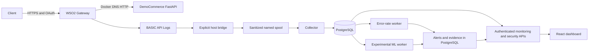

# SentinelAPI

An API security monitoring prototype combining **WSO2 API Manager 4.5.0**, sanitized gateway telemetry, evidence-linked detection, and a React investigation dashboard.

Authentication and rate limits answer whether a request may pass the gateway. Investigating unusual behavior also requires a trustworthy record of what happened. SentinelAPI explores that problem without putting its rule engine or experimental ML in the request path.

**Status:** portfolio research prototype, not production ready. Historical live evidence proves gateway routing and a collector-to-database-to-monitoring slice. The complete live detection/ML/dashboard chain remains unverified. Step 9 is preserved on an unmerged branch; see the [final audit](docs/final-project-audit.md) and [current verification](docs/final-verification.md).

## Implemented features

- FastAPI DemoCommerce: health, profile, orders and simulated payments; business data is in memory.
- WSO2 OpenAPI, revision, OAuth application/subscription tooling and bounded security checks. Actual gateway route: `/democommerceapi/1.0.0`.
- BASIC API Log parsing, route sanitization, durable spool/checkpoints and deterministic event deduplication.
- PostgreSQL monitoring schema, reviewed Alembic migrations and scoped runtime roles.
- Five tested rule strategies; **only error-rate detection has a live evidence adapter**. Other strategies remain disabled.
- Experimental per-API Isolation Forest, finalized minute features, artifact digest checks and evidence-linked anomaly alerts.
- Seven React views with explicit demo provenance, authenticated API clients, memory-only credentials, filters and incident workflows.

## Architecture



Arrows describe implemented connections, not proof of a complete current deployment. WSO2 handles lifecycle, subscription authorization, OAuth enforcement and configurable gateway throttling. SentinelAPI performs asynchronous observation and detection; it does not automatically block requests. [Detailed architecture](docs/final-architecture.md).

## Application evidence

**Actual React application, demo fixtures only.** Counts, services and alerts are illustrative, not live gateway measurements.


**Actual incident view, demo fixtures only.**


The [evidence inventory](docs/final-evidence-inventory.md) distinguishes application captures, genuine synthetic evaluation charts and historical live JSON evidence. Live WSO2 screenshots are still missing.

## Technology

WSO2 API Manager 4.5.0 · Python 3.12 · FastAPI · SQLAlchemy 2 · Alembic · PostgreSQL 17 · Docker Compose · scikit-learn Isolation Forest · React · TypeScript · Vite · Pytest · Vitest · Playwright.

## Try the dashboard

Prerequisites: Git, compatible Node/npm (Node 26.7.0/npm 11.19.0 were used in earlier verification), and the repository lockfile.

```powershell
cd frontend
npm.cmd ci
npm.cmd run dev
```

Open **http://127.0.0.1:5173** and select **Explore demo**. Demo is read-only and never substitutes for failed live requests. For real data, use **Connect backend** with private monitoring/security credentials. Development proxies target loopback 8010/8020; see `frontend/.env.example`. Never put tokens in Vite variables or URLs.

## Run the backend and WSO2 demo

Prerequisites: Python 3.12, Docker Desktop/Compose, the existing WSO2 installation, trusted local WSO2 certificate and private credentials. WSO2 is separately managed: Compose does **not** provision or restore it.

1. Follow the [safe deployment runbook](docs/final-deployment.md). Preserve containers, database data, volumes and WSO2 configuration.
2. Copy `.env.example` to `.env` only if `.env` does not exist. Replace applicable placeholders with distinct private secrets. Optional ML requires an independently approved artifact.
3. Inspect containers/network. Use selected-service `up --no-recreate`; this can preserve stale deployments as well as working ones.
4. Build persistence tooling, back up externally, apply `alembic upgrade head`, check drift and provision scoped roles before runtime services.
5. Inspect/import the real OpenAPI, set backend `http://democommerce:8000`, secure all operations, deploy a revision, publish and subscribe. [WSO2 configuration and context caveat](docs/wso2-api-integration.md).
6. Start collector/monitoring, the explicit host bridge, detector/security API, then frontend. ML is an opt-in overlay.

The runbook includes actual commands, migrations, safe stops, ML evaluation and bounded authorized traffic. Loopback ports: DemoCommerce **8000**, monitoring **8010**, security/ML **8020**, Vite **5173**, optional Nginx dashboard **8080**, Publisher **https://localhost:9443/publisher**, gateway **https://localhost:8243/democommerceapi/1.0.0**. PostgreSQL has no host port. A listening port is not readiness evidence.

## Tests and measured results

```powershell
# Repository root; environment installation is in the runbook.
$env:PYTHONPATH='backend;scripts;collector'
.\.venv-step6\Scripts\python.exe -m pytest backend/tests scripts/tests collector/tests demo-services/democommerce/tests --ignore=backend/tests/test_postgres.py --ignore=backend/tests/test_detection_postgres.py --ignore=backend/tests/test_ml_postgres.py --ignore=backend/tests/test_dashboard_postgres.py --ignore=collector/tests/test_monitoring.py -q
# frontend directory
npm.cmd run lint
npm.cmd run typecheck
npm.cmd test
npm.cmd run build
npm.cmd run test:browser
```

Current audit: **156 Python tests passed, 2 known Windows collector failures, 4 passing subtests**; **36 frontend unit tests** and **7 Chromium tests** passed. Lint/typecheck/build passed. **32 DB-dependent tests were collected, not executed**. The unmerged Step 9 fix is not present here. These are unit, contract, synthetic and browser fixture/mock checks, not full live acceptance.

Historical Step 5 correlated **6 gateway responses with 6 database and monitoring records**, including a rejected request, retaining the count after replay. [Live source report](infrastructure/telemetry/e2e-verification.json).

Controlled synthetic ML evaluation, reproduced in this audit: 360 training minutes, 180 held-out minutes (60 normal, 120 scenarios).

| Detector | Precision | Recall | F1 | False-positive rate |
|---|---:|---:|---:|---:|
| Isolation Forest | 0.931034 | 0.450000 | 0.606742 | 0.066667 |
| Configured error-rate rule | 1.000000 | 0.200000 | 0.333333 | 0.000000 |

These are **synthetic results**, not production attack accuracy. Rule history is 300 seconds; ML windows are 60 seconds. No throughput, live latency or coverage claim is supported. An anomaly is an investigation signal, not confirmed malicious activity. [Evaluation and reproduction](docs/ml-evaluation.md).

## Security, limitations and future work

Secrets belong in ignored configuration or process memory. Stored events omit bodies, headers and raw addresses; source WSO2 logs still need protection. Monitoring has a separate token; security APIs enforce reader/analyst/admin capabilities. Model hashes verify bytes, not publisher trust; joblib artifacts require a trusted operator.

Outstanding work: backend isolation (loopback 8000 bypasses the gateway), observed low-quota HTTP 429, the `/democommerce` context decision, deployment drift, unavailable security API, live DB/detection/ML/dashboard acceptance, dependency advisory review, backups/retention and production identity/TLS. Windows collector portability is fixed only on unmerged Step 9. No public deployment is claimed.

## Engineering notes and portfolio

- [Audit](docs/final-project-audit.md) · [Safe deployment](docs/final-deployment.md) · [Architecture](docs/final-architecture.md)
- [Verification](docs/final-verification.md) · [Evidence inventory](docs/final-evidence-inventory.md)
- [Technical blog draft — unpublished](docs/blog/sentinelapi-wso2-technical-blog.md)
- [Demo video plan — not recorded](docs/demo-video-script.md)
- [Project summary](docs/portfolio/project-summary.md) · [Interview guide](docs/portfolio/interview-preparation.md)
- [Development journal](docs/development-journal.md) · [Release/PR plan](docs/final-release-plan.md)

Published blog URL: pending. Repository: [SentinelAPI on GitHub](https://github.com/Kaveesha23dil/sentinelapi).
