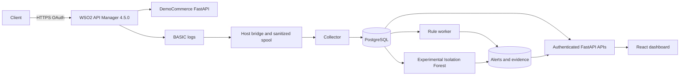
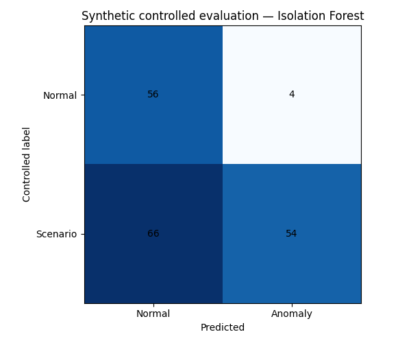
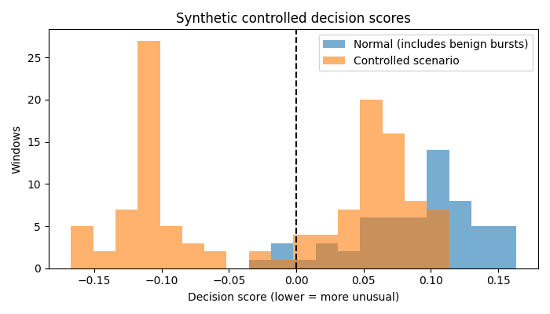
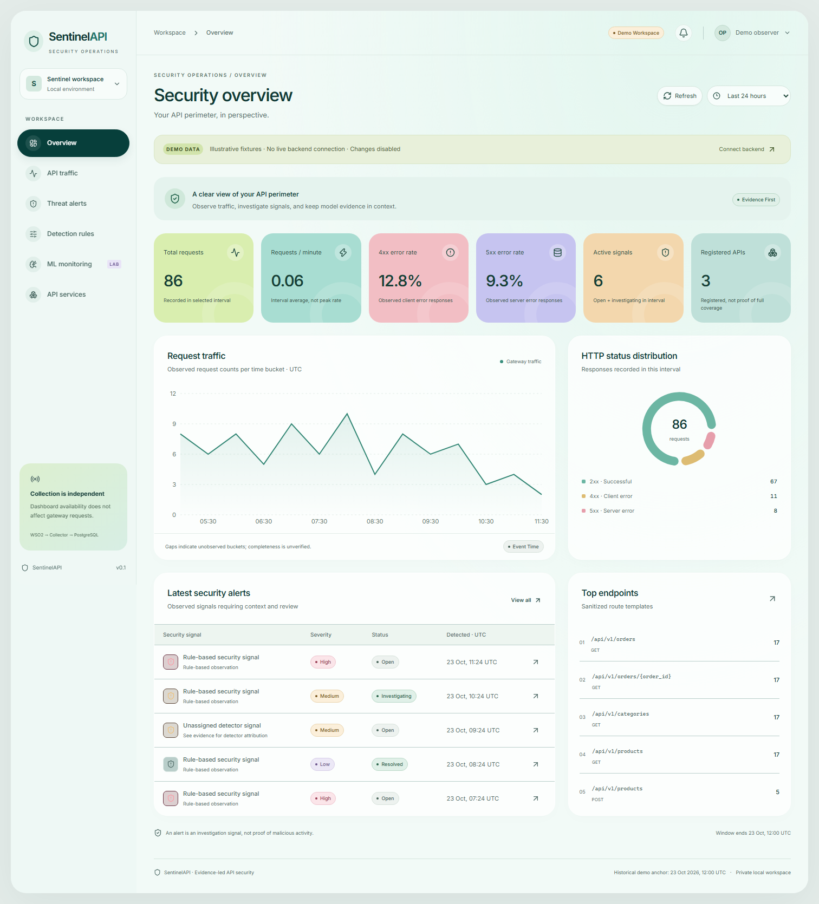
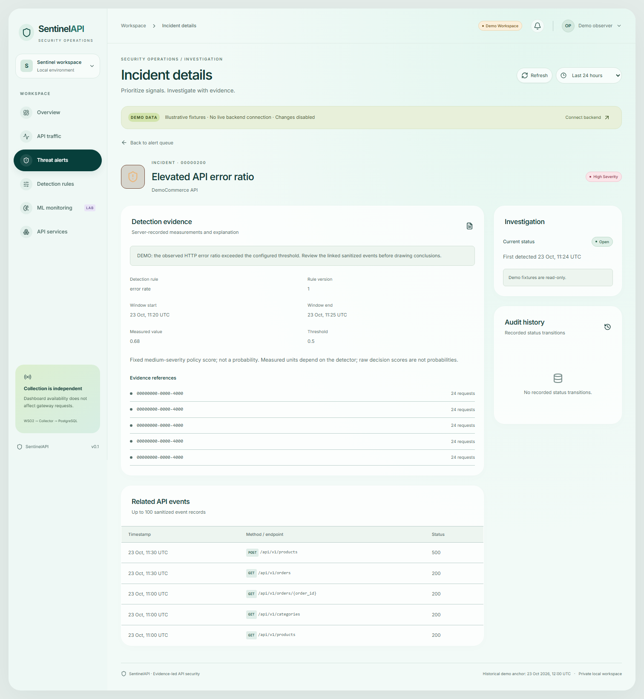

# Beyond API Rate Limiting: Building an Intelligent API Security Monitoring Platform with WSO2 API Manager and Machine Learning

**Unpublished engineering draft.** Audited against source `f931455` on 2026-10-24. This article describes a portfolio prototype, with explicit separation between historical live WSO2 evidence, controlled synthetic evaluation and dashboard fixtures. Step 9 remains unmerged and live acceptance is incomplete. Editorial TODOs below must be resolved or retained honestly before publication.

## The problem I wanted to explore

An API can accept a valid token and still receive unusual traffic. A high error ratio may indicate a broken client, a deployment regression or deliberate probing. A burst may be legitimate. Authentication and quotas provide useful enforcement, but they do not by themselves explain the behavior an engineer needs to investigate.

I built SentinelAPI to explore that investigation layer around WSO2 API Manager. The project combines a small FastAPI backend, sanitized gateway telemetry, PostgreSQL persistence, rule-based observations, an experimental Isolation Forest pipeline and a React dashboard. My goal was to preserve a chain from an observation to its underlying evidence, while avoiding conclusions the available data could not support.

The result is a research prototype rather than a production security product. I have historical live evidence for gateway routing and telemetry ingestion. I have executable rule/model tests and a reproducible synthetic ML experiment. I do not yet have a verified fresh chain from WSO2 through rule/ML alerts into the live dashboard.

## Why WSO2 API Manager

WSO2 gave the project a concrete API management boundary: an OpenAPI definition, secured operations, application subscriptions, token issuance and gateway deployment. I could investigate the difference between defining an API, publishing it for consumers and installing a revision on a gateway. WSO2 documents revisions as the mechanism for deploying API snapshots; this distinction helped me avoid treating a Publisher lifecycle label as routing proof. [Official API revision documentation](https://apim.docs.wso2.com/en/4.5.0/manage-apis/design/create-api/create-api-revisions/).

I kept responsibilities separate. WSO2 enforces gateway authentication/subscription policies and supports configured rate limits. SentinelAPI observes stored activity asynchronously. My own detector neither validates the gateway's OAuth token nor automatically blocks traffic.

## Architecture and technology choices

These arrows represent code paths, not a claim that every path is accepted live. Python/FastAPI provides the demo service and monitoring APIs; SQLAlchemy/Alembic manage persistence; Docker Compose defines local services; React/TypeScript provides the investigation interface. WSO2 remains separately managed rather than being silently replaced by a new Compose stack.

I chose an out-of-band detector so a monitoring failure would not be added to the gateway request path. That has a cost: freshness depends on the bridge, collector, event-time windows and worker backlog. A healthy HTTP process cannot establish telemetry completeness.

## Building DemoCommerce

DemoCommerce exposes six operations: health, a fixed demo profile, listing/creating orders, reading an order and simulating payment. Orders use Decimal totals and a lock around shared in-memory state. Missing orders return 404; creation returns 201. Payment simulation changes demo order state but does not contact a payment provider.

This bounded backend made routing and response behavior testable without introducing a real commerce integration. It is deliberately not a persistent business system: restarting it recreates its initial orders. The `/users/me` identity is a fixed fixture, not authenticated identity propagation from WSO2. PostgreSQL stores monitoring records, not the commerce domain.

## Publishing, OAuth and throttling

The existing API is DemoCommerceAPI 1.0.0 at `/democommerceapi/1.0.0`, forwarding to `http://democommerce:8000` through Docker DNS. Using localhost inside the gateway would point back to the gateway container. My tooling inspects the existing API before changing it, secures operations, handles revisions and verifies actual routing.

Historical gateway checks recorded 401 without a token, 200 with a subscribed application token, 201 on order creation and a matching read-back through the backend. The final tested token lifetime was 300 seconds, and revocation was submitted afterward. The tooling originally received a one-hour token despite the requested validity; inspecting the actual JWT timestamps and updating the application's supported OAuth key expiry configuration resolved the final token-lifetime check. Decoding timestamps alone did not verify the JWT signature; gateway acceptance supplied the authentication observation. The application-token flow uses client credentials. [Official client credentials documentation](https://apim.docs.wso2.com/en/4.5.0/manage-apis/design/api-security/oauth2/grant-types/client-credentials-grant/).

Two limits remain important. The originally requested context `/democommerce` was not applied to the existing API; supported updates preserved its context, so I documented the mismatch rather than editing WSO2's database. Also, the unauthenticated backend is still reachable on host loopback 8000. OAuth at the gateway is not backend isolation.

I inspected the available 10PerMin policy, but have no retained observed low-quota HTTP 429 result. A bounded test script exists; it is not evidence that enforcement passed. WSO2's application, subscription and other policy levels need deliberate configuration and actual observation. [Official throttling-policy documentation](https://apim.docs.wso2.com/en/4.5.0/manage-apis/design/rate-limiting/adding-new-throttling-policies/).

**Editorial TODO:** capture the actual Publisher overview and sanitized OAuth results after restoring trusted TLS. Capture throttling only after a dedicated authorized test really observes it. Current gateway probing fails certificate verification; I have not bypassed that check.

## BASIC logs: useful observations and missing information

I enabled BASIC API Logs for the intended API through WSO2's supported DevOps API. BASIC includes routing/correlation/flow/status information, while higher log levels add headers and payloads. I did not need those additional sensitive fields. [Official API Logs documentation](https://apim.docs.wso2.com/en/4.5.0/monitoring/observability/logs/monitoring-api-logs/).

The installed log stream contained REQUEST_IN, REQUEST_OUT, RESPONSE_IN and RESPONSE_OUT. I normalize only RESPONSE_OUT into a completed event. In a controlled live proof, six requests produced 22 flow records but only six completed responses. Counting every flow as a request would have inflated traffic. One rejected no-token request had a completed response without backend-facing flows, so backend logs alone would not have represented that observation.

The observed BASIC format did not provide a trustworthy duration or stable application/client identity. I store NULL rather than inventing either. Source addresses are discarded before the separate spool/database, and order IDs are reduced to route templates. The raw gateway log still contains addresses; downstream sanitization does not remove the need to protect source files.

Because the existing gateway had no shared log mount, I implemented an explicit host bridge instead of recreating it. The bridge reads bounded chunks using Docker exec, sanitizes in memory and sends allowlisted JSON to a network-disabled transport helper. The collector gets a read-only spool mount, not the Docker socket or WSO2 administrator credentials. Source checkpoints, complete-line handling and spool limits support retry, but a long outage can still outlast gateway retention.

## PostgreSQL persistence and deduplication

Monitoring persistence uses UUID keys, TIMESTAMPTZ, JSONB for structured evidence/configuration and bounded API/time queries. The schema began with services, traffic events, aggregates, rules, alerts, evidence and audit records; later migrations add detection checkpoints and ML windows. Migrations are additive and separate from runtime ingestion.

A deterministic UUID5 combines the API namespace, source correlation UUID, completion timestamp, method and sanitized endpoint. The database uniquely constrains event IDs. Identical replay is idempotent; different content under the same identity raises a conflict instead of overwriting evidence. The public event reference is a collector deduplication ID, not a gateway correlation ID presented to users.

Historical database verification executed 26 tests and a disposable migration cycle with a restart persistence marker. Step 5 then correlated six real gateway completions with six stored and monitoring records, retaining the count after replay. A later bounded snapshot matched 21 completions. Those reports are dated observations, not proof that the current detector schema, grants or collector are healthy. [Retained live ingestion report](../../infrastructure/telemetry/e2e-verification.json).

## Rules that respect the evidence available

The rule engine contains request flood, error rate, enumeration, authentication failures and unusual-activity strategies. Only error rate currently has a trusted live adapter and is enabled by default. It requires at least 20 requests and an error ratio above 0.5 in a 300-second window.

The distinction is intentional. A 404 alone is not proof of route enumeration, and 401 alone does not establish the authentication-failure evidence required by the intended strategy. Without trusted client identity, client-based grouping would be misleading. The unavailable adapters stay explicit rather than being approximated with source IPs or response codes.

The worker uses event-time slices, a 120-second lateness allowance, advisory locking and atomic alert/checkpoint commits. Versioned incident fingerprints suppress duplicate incidents; evidence links back to selected events. A 10,000-event guard rolls back rather than silently truncating a window. That favors visible failure over a successful-looking incomplete result. Events beyond the replay allowance still need deliberate historical replay.

## Feature engineering and Isolation Forest

The feature schema `api-60s-v1` contains seven per-API minute features: request count, 4xx ratio, 5xx ratio, number of endpoint templates, GET ratio, POST ratio and status-code diversity. It excludes latency and client identity. Partial-edge windows are excluded, low-volume windows are ineligible and conflicting duplicate events fail closed.

The pipeline fits its imputer, scaler and Isolation Forest on training windows. The configured experiment uses 200 trees, contamination 0.05, random state 42 and one worker. Input validation rejects missing/nonfinite features rather than treating unavailable measurements as benign zeroes. At least 60 eligible training windows is a technical guard, not proof of an adequate operational baseline.

Models are scoped to one API and carry feature order, schema, data digest, provenance and dependency versions. Loading requires a local operator-approved digest, checks the exact bytes before deserialization and validates compatibility. This does not make arbitrary joblib artifacts safe: a checksum is not authorship or trust. Synthetic identity cannot simply be edited into a live API baseline.

Inference runs separately from rules. Raw `decision_function` scores are stored with model/window/features; negative scores are unusual under the fitted model, not attack probabilities. Anomaly alerts use a fixed medium policy score rather than invented confidence, and retain event links for review.

## Evaluation: what the numbers actually mean

I generated 25,953 explicitly synthetic events over 540 minutes: 360 training minutes and 180 held-out minutes, with 60 normal and 120 controlled scenario windows. Normal data includes benign bursts; scenario blocks include moderate cases. Labels do not enter model training. The audit reproduced the same model version and metrics.

| Detector | Precision | Recall | F1 | False-positive rate | TN / FP / FN / TP |
|---|---:|---:|---:|---:|---|
| Isolation Forest | 0.931034 | 0.450000 | 0.606742 | 0.066667 | 56 / 4 / 66 / 54 |
| Configured error-rate rule | 1.000000 | 0.200000 | 0.333333 | 0.000000 | 60 / 0 / 96 / 24 |

*Genuine generated evaluation chart, controlled synthetic data only. Not live attack detection.*

*Normal/controlled-scenario overlap illustrates the limits of behavior-only features.*

The 66 missed scenario windows matter as much as precision. The rule evaluates actual generated events with 300-second history; ML scores 60-second windows. Volume scenarios are outside the error-rate rule's purpose. This is a configured comparison, not proof that ML is universally superior. Neither the labels nor an anomalous score establish malicious intent in deployment. I have no measured production accuracy or live inference latency. [Reproduction and metrics](../ml-evaluation.md).

## Dashboard and incident investigation

The React dashboard has Overview, Traffic, Alerts, Incident Details, Rules, ML Monitoring and Services views. Real requests use typed contracts and separate authenticated monitoring/security capabilities. Tokens stay in memory. Cancellation prevents an older connection attempt from restoring credentials after disconnect. Demo mode is explicit, read-only and never a fallback after a live API failure.

*Actual running application; all displayed traffic/alerts are fixtures.*

*Fixture incident investigation. This image does not prove a live alert or persisted status update.*

The interface keeps missing health/latency and experimental provenance visible. It polls active live views rather than implying a streaming infrastructure that does not exist. The current deployed monitoring session route is absent and security API 8020 is unavailable, so I cannot present these captures as the completed live dashboard connection.

## Testing and performance boundaries

During finalization I executed 156 passing Python tests and four passing subtests, with two existing Windows collector failures. Frontend lint, typecheck and production build passed; 36 unit tests and seven actual Chromium tests passed. Browser tests include real rendering/accessibility and explicitly mocked API workflows. Thirty-two DB-dependent tests were collected but not run against project data.

The unmerged Step 9 branch contains a Windows directory-fsync portability fix and a guarded live test harness. Its recorded offline suite passed 161 tests plus four subtests; its explicit live-security run had two passes, ten failures and five skips. I kept that separate from the current branch's results. The live failures include unavailable security services, TLS trust and backend isolation; they are not replaced by mock test passes.

No controlled performance workload completed. Step 9's benchmark wrapper refused to proceed without trusted TLS, dedicated application credentials and explicit opt-in. I therefore have no throughput, p50/p95 or server-resource numbers to report. A fast throttled response would also need separate interpretation from successful business-request latency.

## Challenges and lessons

The most useful failures exposed mismatches between claims and evidence. WSO2 preserved an existing context during updates. Requested token validity differed from the token actually issued. Multiple log flows represented one completed request. Missing telemetry fields constrained which detectors were defensible. Each case required observing the deployed behavior rather than assuming configuration intent was enough.

Windows portability also mattered: POSIX directory fsync code raises `O_DIRECTORY` errors on this host. Step 9's separate fix preserves file fsync/atomic replacement while explicitly acknowledging weaker Windows directory durability; it is not yet merged. On the frontend, responsive testing found an overflowing accessibility label, and connection tests exposed stale asynchronous session updates. The journal records fixes and actual reruns rather than removing failing evidence.

The final runtime audit found a stale collector and deployed monitoring routes inconsistent with source. That is a deployment problem a green unit suite cannot settle. Dependency review also remains open: Step 9's installed-environment audit recorded advisories, including a runtime transitive package. They require compatibility-aware remediation and retesting, not an unsupported security certification.

My main lesson is that an investigation tool needs provenance for its own outputs. Missing data should stay missing, replay should preserve identity, and demonstration fixtures should never become evidence of a live security result.

## Next improvements

I would first reconcile the existing deployment, integrate the reviewed Step 9 fix and execute guarded DB and full live correlation checks. Then I would verify gateway-only isolation and dedicated low-quota throttling, evaluate real API history without claiming unlabeled attack accuracy, and implement trusted identity/route/auth adapters before enabling additional rules.

Further work includes dependency updates, backup/restore validation, retention, production identity/TLS, audit integrity and controlled performance measurement. I would record the demo only after verifying the selected screens and attach real live captures when available.

## Closing and source

SentinelAPI gave me a concrete way to investigate the boundary between API management, telemetry engineering and anomaly detection. Its strongest supported result is a documented prototype with historical live ingestion, tested source behavior and a reproducible controlled experiment. Its remaining acceptance gaps are part of that engineering record.

Source: [SentinelAPI on GitHub](https://github.com/Kaveesha23dil/sentinelapi). [Final audit](../final-project-audit.md), [verification](../final-verification.md), [evidence inventory](../final-evidence-inventory.md) and [demo plan](../demo-video-script.md).

**Editorial TODOs before publication:** review first-person wording with the owner; decide limited-prototype publication versus waiting for live acceptance; resolve Step 9 integration status; add genuine Publisher/OAuth/telemetry/DB/live alert images if obtained; retain explicit limitations if not; recheck test counts/references; approve platform/author/title; publish only with approval. Published URL and video URL are not available. No publication is claimed by this draft.
