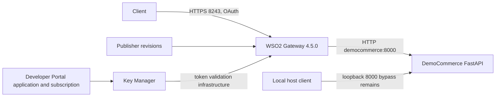
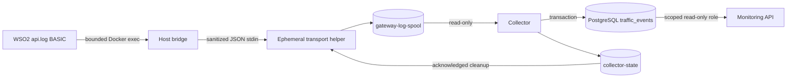
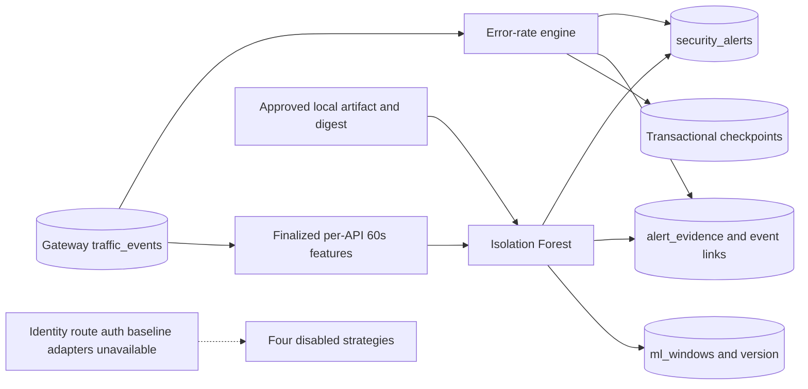
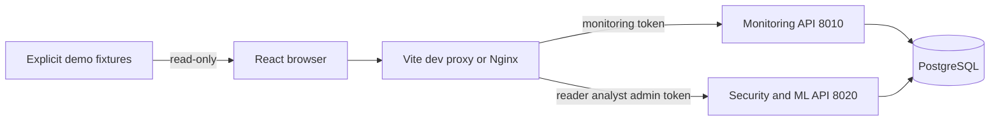
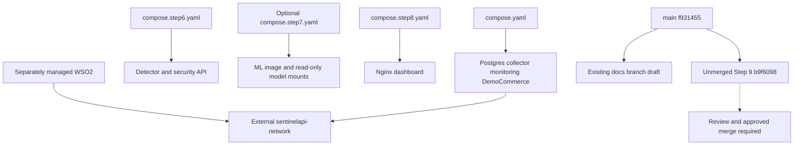

# Final architecture and verification boundaries

Source baseline `f931455`; audit 2026-10-24. Solid arrows represent implemented paths, not current readiness. Step 5 historically verified gateway-to-monitoring ingestion. The complete detection/ML/dashboard live chain remains pending. There is no automatic mitigation connection.

## Request path and management plane

Publisher/Developer Portal use loopback 9443. OAuth enforcement belongs to WSO2. Subscription, publication and revision deployment are separate operations. Actual context is `/democommerceapi`; requested `/democommerce` remains unresolved. WSO2 is outside this Compose project. DemoCommerce business data is in memory, separate from monitoring persistence.

## Monitoring

The bridge polls every 15 seconds and runs explicitly on the host. Containers do not receive the Docker socket. Only RESPONSE_OUT becomes an event. UUID5 uses API namespace, source correlation UUID, completion timestamp, method and normalized endpoint; it is a dedup ID, not an exposed gateway correlation ID. Unique IDs and content-conflict checks prevent unsafe overwrites.

Sanitization discards sourceIP and unknown fields, templates order IDs and maps unknown paths to `/{unmapped}`. Latency and client identity are NULL because the observed BASIC records cannot support them. Raw gateway files still need privacy controls. Missing completions cannot be reconstructed by this pipeline.

## Detection

Workers use 60-second slices, 300-second rule history, 120-second lateness and a 10,000-event capacity guard. Advisory locks serialize work; alerts/checkpoints commit together. Versioned incident fingerprints suppress duplicates. Beyond-lateness history needs explicit replay; completeness is not guaranteed by process health.

Only error_rate has a live adapter: at least 20 requests and HTTP 400–599 ratio >0.5 over 300 seconds. A 401 is not proof of an auth attack; 404 alone is not enumeration. Other pure strategies are tested but lack trusted evidence adapters.

ML uses request count, 4xx/5xx ratios, endpoint count, GET/POST ratios and status diversity. It runs out of band in an independent failure domain. Unique `(window_id, model_version)` prevents repeated scores. Evidence retains raw score, features, model/window and event links. Policy score 50 is not confidence. A synthetic API model cannot be relabeled to score a live API.

## Dashboard

Monitoring/security share a FastAPI application under different environment/DB roles. Server capability checks authorize actions; browser credentials stay in memory. Cancel/disconnect prevents stale connection verification. Active views poll at 30 seconds; no SSE/WebSocket exists. Production Nginx disables demo entry and proxies same-origin requests; container acceptance is pending. Fixture products and services are not extra deployed business APIs.

## Deployment and Git

The internal DB network has no host database binding. Monitoring-network joins HTTP-facing services. Builds do not update running containers; `--no-recreate` can preserve deployment drift. Named volumes are not backups. See [safe deployment](final-deployment.md).
