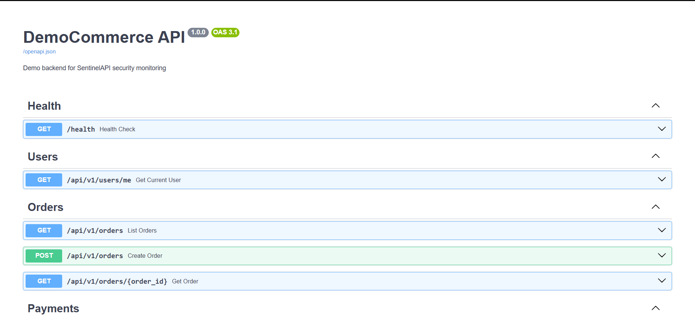
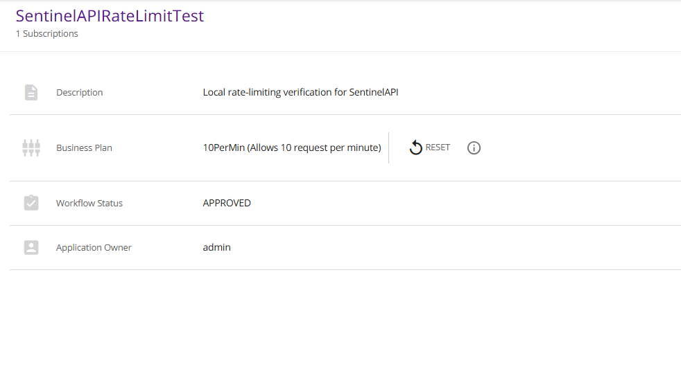
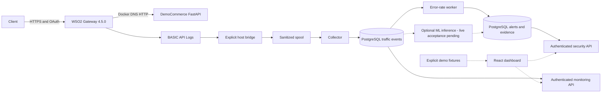
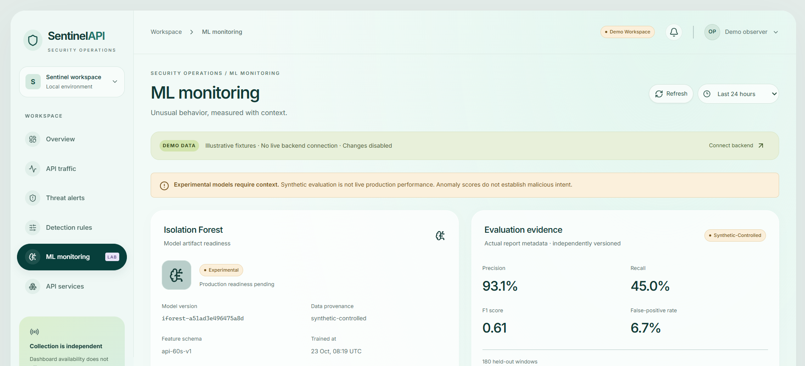

# Beyond API Rate Limiting: Building SentinelAPI with WSO2 API Manager and Experimental Anomaly Detection

*Unpublished engineering draft for owner review. Application baseline: `891a269`; current release checks and screenshot decisions are linked below. This is a local portfolio prototype, not a production security claim.*

## Why I built it

A valid API token answers an access question. It does not explain why a client is producing errors or whether an unusual request pattern deserves investigation. A quota can limit traffic, but an engineer still needs enough context to distinguish a broken integration, an expected test and a potentially hostile pattern.

I built SentinelAPI to explore that investigation layer around WSO2 API Manager. The project combines a small FastAPI commerce backend, gateway telemetry, PostgreSQL, explainable rules, an experimental Isolation Forest pipeline and a React dashboard. The engineering goal was to connect an observation to its source evidence without inventing missing measurements or treating anomalies as confirmed attacks.

Three evidence categories matter throughout this article:

- **Controlled local runtime:** actual WSO2 requests, collected completions, persisted events and a genuine rule alert generated by deliberate local error traffic.
- **Controlled synthetic ML evaluation:** generated events and scenario labels used for a reproducible experiment, independent of the live API baseline.
- **Demo fixtures:** clearly labeled React examples used to develop and test investigation workflows.

The current runtime supports the first category through authenticated API retrieval. Live ML scoring and an authenticated end-to-end dashboard session remain separate acceptance work. The dashboard pictures in this article are fixtures.

## Start with a bounded backend

DemoCommerce exposes six operations: health, a fixed profile, listing and creating orders, retrieving an order, and simulating payment. Decimal totals and a lock around in-memory orders keep the demo behavior predictable. Missing orders return 404; creation returns 201. Simulated payments do not contact a payment provider.

*Figure 1 — Actual OpenAPI documentation. An operation list or schema example is documentation, not proof that an HTTP request executed successfully.*

I kept business data in memory so the backend stayed small enough for routing experiments. PostgreSQL stores monitoring evidence, not the order domain. The fixed `/users/me` profile is a demo identity, not propagated end-user identity from WSO2. Those boundaries prevent the small service from appearing to be a complete commerce or identity system.

## WSO2's role: management and enforcement

The actual API is DemoCommerceAPI 1.0.0 under `/democommerceapi/1.0.0`, with a Docker-DNS backend at `http://democommerce:8000`. WSO2 manages the definition, lifecycle, gateway revisions, subscriptions and OAuth enforcement. SentinelAPI's detector does not validate gateway tokens or automatically block requests.

*Figure 2 — Actual Publisher configuration showing PUBLISHED, OAuth2 and the deployed context. Publication alone is not a routing test.*

Historical gateway checks recorded 401 without a token, successful subscribed access, order creation and matching read-back. The supported tools inspect existing applications and API revisions rather than replacing configuration. WSO2 distinguishes deploying a revision from publishing an API, which is why I retained actual request/read-back checks alongside lifecycle observations. [Official revision documentation](https://apim.docs.wso2.com/en/4.5.0/manage-apis/design/create-api/create-api-revisions/).

The original requested context was `/democommerce`; the existing API retained `/democommerceapi` during supported updates. I documented that difference instead of editing WSO2's database or replacing an API to hide it. A second integration issue was token validity: an early request for a short-lived token initially yielded a longer lifetime. The final recorded check used the supported per-application expiry configuration and verified a 300-second lifetime, with revocation submitted after testing. JWT timestamp decoding was not treated as signature verification.

*Figure 3 — Actual application configuration for a dedicated rate-limit test. It proves configuration, not precise enforcement timing or throughput.*

The supplied terminal captures show HTTP 200 followed by 429, and PostgreSQL retains nine genuine gateway 429 events. Those terminal images are excluded from publication because of personal paths; some commands also used TLS bypass. The trusted-certificate controlled alert validation is a different run. The existing policies were not weakened to obtain the alert. [Official throttling-policy documentation](https://apim.docs.wso2.com/en/4.5.0/manage-apis/design/rate-limiting/adding-new-throttling-policies/).

**Editorial gap:** clean response-only OAuth and throttling captures would improve this section. The authorized screenshot supplied for review exposes a bearer token and is not embedded. I have not transcribed or cosmetically edited it into publishable evidence.

## Architecture: keep observation outside the request path

The request path is Client → WSO2 → DemoCommerce. Gateway logs originate at WSO2, not at DemoCommerce. The bridge, collector and workers are asynchronous observers. Solid monitoring/rule connections are backed by retained local validation; dashed ML connections exist in source but are not currently enabled with a live artifact. React has API client integration, while the published screenshots demonstrate fixture rendering rather than a proven live session.

This separation keeps the detector out of request admission. It also means freshness has to be measured independently. A running Uvicorn process cannot prove that logs are arriving or that a worker is consuming them.

## BASIC logs and the importance of counting completions

WSO2 BASIC API Logs expose flow and response information without the headers and payloads added by higher levels. I enabled the intended API through the supported DevOps API and inspected the installed format. [Official API Logs documentation](https://apim.docs.wso2.com/en/4.5.0/monitoring/observability/logs/monitoring-api-logs/).

A request can appear as REQUEST_IN, REQUEST_OUT, RESPONSE_IN and RESPONSE_OUT. Only RESPONSE_OUT becomes a persisted completion. In a retained six-request live proof, there were 22 flow records but six final responses; the rejected request did not have backend-facing flows. Counting every record as a request would have overstated volume and obscured gateway rejection behavior.

The observed BASIC records did not establish trustworthy duration or stable client/application identity. I therefore store NULL latency and client identity. Source addresses and unknown fields are dropped before the separate spool; order IDs are normalized to a route template. The raw gateway files still contain addresses and need their own access and retention controls.

Because WSO2 was already managed independently without a shared log mount, I used an explicit host bridge rather than recreating it. Bounded Docker exec reads feed sanitized JSON into a network-disabled transport helper. The collector receives a read-only spool and its own writable checkpoint volume, not the Docker socket or WSO2 administrator credentials. Rotation checks, complete-line handling and spool limits make failure visible, although an outage beyond gateway retention can still lose history.

**Editorial gap:** the supplied raw-log screenshot contains source addresses and is excluded unchanged. The source observations and sanitized reports remain linked from the repository; a clean authorized view can be captured later.

## PostgreSQL: stable identity and transaction boundaries

The schema uses UUIDs, TIMESTAMPTZ, constraints and structured JSONB. Services link to traffic events; alerts link to evidence; audit records capture controlled management changes. Additive migrations introduced detection checkpoints and ML windows without resetting the original telemetry.

The collector derives a UUID5 from API namespace, source correlation UUID, completion timestamp, method and normalized endpoint. A unique event ID makes identical replay idempotent. Conflicting content under the same identity is rejected instead of overwriting evidence. The dashboard's event reference is that deduplication ID, not a gateway correlation ID exposed as though it were an independent client identity.

*Figure 4 — Actual sanitized SQL rows with source `wso2-gateway`. Displayed event timestamps belong to those records; the capture time is unknown. These rows are not a benchmark.*

Earlier verification correlated six actual gateway completions with six database and monitoring records and retained the count after replay. The detection repair later verified that all original 75 events remained present after a controlled 24-request run. Current read-only release checks found 99 gateway events at Alembic revision `b7d000000001`.

Owner-run migrations/provisioning are separate from runtime identities. The detector uses a scoped role that reads traffic but cannot insert it. Integration tests use a guarded `sentinelapi_test_*` database, so synthetic test rows are never presented as genuine project telemetry.

## Rule detection: use only evidence the adapter can support

Five pure strategies are implemented: flood, error rate, enumeration, authentication failures and unusual activity. Only API-level error_rate has the current trusted live adapter and is enabled by default. It requires at least 20 requests with an HTTP 400–599 ratio strictly above .5 over 300 seconds.

Without trusted client identity, a client-based flood grouping would be misleading. A 404 alone does not prove enumeration; 401 alone does not establish a confirmed authentication attack. The unsupported adapters remain disabled rather than being approximated with insufficient data.

The worker uses bounded event-time slices, 120 seconds of lateness, advisory locks and atomic alert/checkpoint commits. Versioned incident fingerprints suppress duplicate incidents. Capacity overflow rolls back instead of silently truncating an input window. Historical events beyond the supported replay allowance need an explicit replay plan; a fresh controlled workload is safer than resetting production checkpoints for a demonstration.

The retained controlled run used the existing application and generated 24 read-only requests: four successful order-list calls and twenty deliberate nonexistent-order responses. All 24 were matched to BASIC completions and persisted event identities. No alert row was inserted manually.

The first qualifying window contained 20 requests and 16 errors: ratio .8 > .5. After the normal lateness guard, the worker created **Observed API error-rate spike** at **2026-10-24 07:52:41.065997 UTC**, severity medium, risk score 50, status open, with 16 unique linked error events. The score is a policy value, not confidence or a probability of compromise.

*Figure 5 — Genuine controlled local alert evidence. This limited query displays 12 rows; separate SQL/API verification counted all 16 links. The intentional 404 workload is not a real-world attack.*

The immutable incident snapshot need not include later requests after the first threshold crossing. A clean worker stop returned exit 0, then startup resumed its stored checkpoint without adding a duplicate. The current release audit re-read the stored alert and evidence; it did not generate a new workload. [Actual repair report and commands](detection-runtime-repair.md).

## Fixing deployment instead of weakening health checks

The runtime repair exposed a useful distinction. Monitoring had a valid token and a working health route, but returned 503 because the collector was stale. Resuming the bridge made the old probe pass before any image replacement. Separately, the image was behind source and lacked a session route; the service had only `image`, so `docker compose build monitoring` had nothing to build.

I added the existing Dockerfile build definition to monitoring and updated only that stateless service. Uvicorn still did not start detection: the worker needed its own Compose service and scoped database roles. The root-directory Python command also needed `backend` on PYTHONPATH; moving or duplicating the package was unnecessary.

Provisioning previously issued ALTER ROLE during every grant refresh. The repaired command now preserves existing passwords unless explicit rotation is requested and refuses privileged pre-existing runtime roles. The authenticated probe logs only allowlisted reasons, and a Docker stop lets the worker complete its current transaction. These changes addressed deployment causes without removing authentication or changing the detector threshold.

## Isolation Forest: a separate experiment

The feature schema `api-60s-v1` contains request count, 4xx/5xx ratios, unique endpoint templates, GET/POST ratios and status-code diversity. It excludes unavailable latency and client identity. Partial-edge windows are excluded; low-volume or missing-field windows are ineligible. The pipeline fits preprocessing and Isolation Forest on training data only.

The controlled generator produced 25,953 synthetic events over 540 minutes: 360 training minutes and 180 chronological held-out minutes, including 60 normal and 120 scenario windows. Normal data includes benign bursts and the evaluation retains ambiguous cases. Labels do not enter the training matrix. The configuration uses 200 trees, contamination .05, seed 42 and one worker.

The release rerun reproduced model `iforest-a51ad3e496475a8d` and these results:

| Detector | Precision | Recall | F1 | False-positive rate | TN / FP / FN / TP |
|---|---:|---:|---:|---:|---|
| Isolation Forest | .931034 | .450000 | .606742 | .066667 | 56 / 4 / 66 / 54 |
| Configured error-rate rule | 1.000000 | .200000 | .333333 | .000000 | 60 / 0 / 96 / 24 |

These are synthetic-label results, not production attack accuracy. The rule uses its real 300-second history while ML scores 60-second windows, and volume scenarios are outside the error-rate rule's purpose. The 66 missed scenario windows matter; the comparison does not establish universal ML superiority. [Methodology and reproduction](ml-evaluation.md).

Artifacts are immutable, per-API and bound to schema, feature order, data digest, configuration, provenance and library versions. Loading requires an independently approved local digest and exact-byte validation before deserialization. A checksum is not trusted authorship; joblib artifacts can execute code and must not be supplied by untrusted users. A synthetic API identity cannot be edited into a valid live baseline.

Current runtime checks found **no configured ML artifact and zero persisted ML windows**. The inference integration exists and is tested, but I do not describe it as live detection. Raw negative decision scores mean unusual under the fitted model, not malicious or a calibrated attack probability.

## The dashboard and its provenance boundary

The React/TypeScript interface supplies Overview, Traffic, Alerts, Incident Details, Rules, ML Monitoring and Services views. Typed contracts, memory-only credentials and server capability checks keep authorization explicit. Cancellation prevents an old connection attempt from restoring credentials after disconnect. Demo is read-only and never substitutes for a failed authenticated request.

*Figure 6 — Actual dashboard rendering with illustrative fixture counts. The banner explicitly says no live backend connection; these are not the 99 stored runtime events.*

*Figure 7 — Demo UI with the retained synthetic evaluation reference. It is not proof of a deployed live model or genuine anomaly windows.*

The APIs currently return the genuine stored alert/evidence under authentication. Browser tests verify fixture rendering, accessibility, filtering and mocked authorization flows. Those are valuable checks, but they do not prove an authenticated live dashboard session. The source has bounded polling rather than an invented streaming infrastructure.

## What the release tests actually passed

The current audit executed 155 host backend/tool/DemoCommerce passes plus four passing subtests; 21 guarded PostgreSQL checks; and 31 Linux collector/monitoring checks. Frontend lint, typecheck and build passed, as did 36 unit tests and seven Chromium tests. Counts overlap across commands and should not be summed as unique coverage.

Direct Windows collector fixtures still produced **18 passes and two failures** at `os.O_DIRECTORY`. The unmerged Step 9 branch contains a portability fix. The deployed bridge writes guarded host checkpoints and uses Linux transport, so its successful runtime path does not erase those Windows fixture failures. Raw reports are retained privately; [release verification](release-verification.md) records exact commands, counts and limits.

No benchmark workload completed, so there is no throughput, p50/p95, server overhead or live inference latency claim. A fast throttled response would not be successful application latency anyway. No passing-build badge or production readiness follows from this test set.

## Lessons and next work

The most useful lessons came from mismatches: a requested context differed from the existing API; requested token validity differed from issuance; four log flows did not mean four requests; a running server did not mean fresh telemetry; a schema example was not an executed response; and a demo screenshot was not a live integration result.

Provenance has to travel with the evidence. NULL is more useful than invented latency, an unsupported rule should stay disabled, and a known failed test should stay visible. Screenshot review is part of that discipline: the supplied bearer-token/raw-address images remain excluded unchanged, and safe copies retain exact original bytes.

Before broader release I would integrate the reviewed Windows fix, remediate dependency findings, validate backend isolation and production identity/TLS, establish backup restoration and retention, and complete approved real-API ML and live dashboard acceptance. Backend loopback 8000 still bypasses the gateway; raw source logs need protection; hashes are not signatures; and an experimental model needs a real behavioral baseline before promotion.

SentinelAPI is an engineering prototype with a genuine controlled rule-alert path and a reproducible synthetic experiment. Its portfolio value lies in the integration work, transaction and privacy decisions, observed failures and explicit limits, rather than a claim of proven attack prevention.

Repository: [SentinelAPI on GitHub](https://github.com/Kaveesha23dil/sentinelapi). [Evidence/privacy audit](release-evidence-audit.md), [current verification](release-verification.md), [safe deployment](final-deployment.md) and [release checklist](portfolio-release-checklist.md).

*Publication remains pending owner review. Clean OAuth/log/alert-summary recaptures are editorial gaps; no public blog URL, video, tag, release or deployment is claimed. The 13-image inventory includes supplementary fixture/configuration views without implying that all must be embedded in the final article.*
